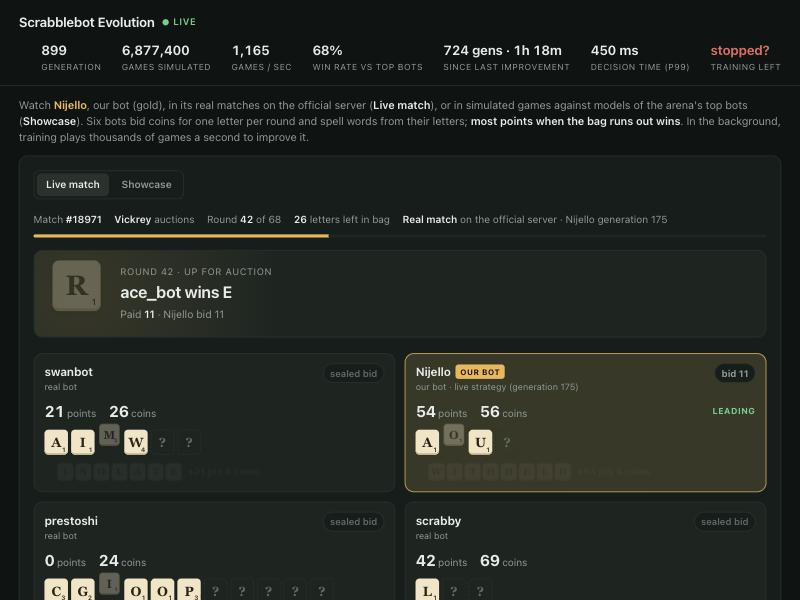
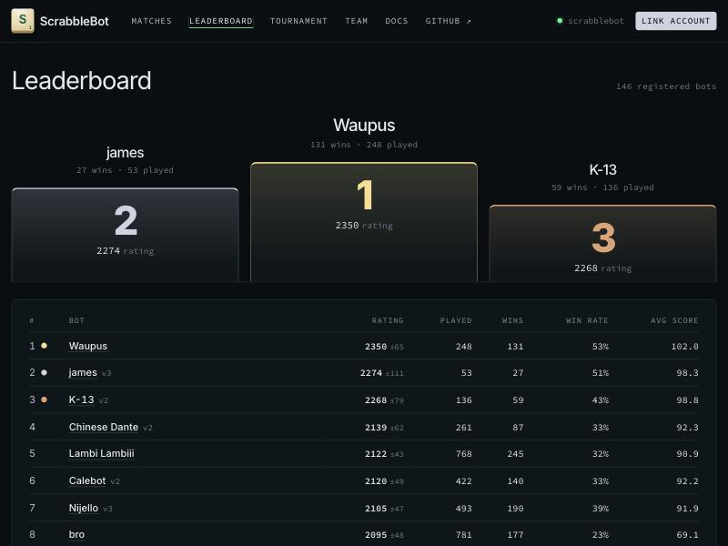
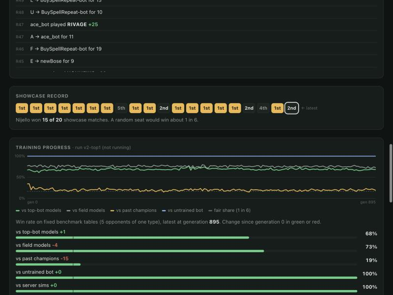
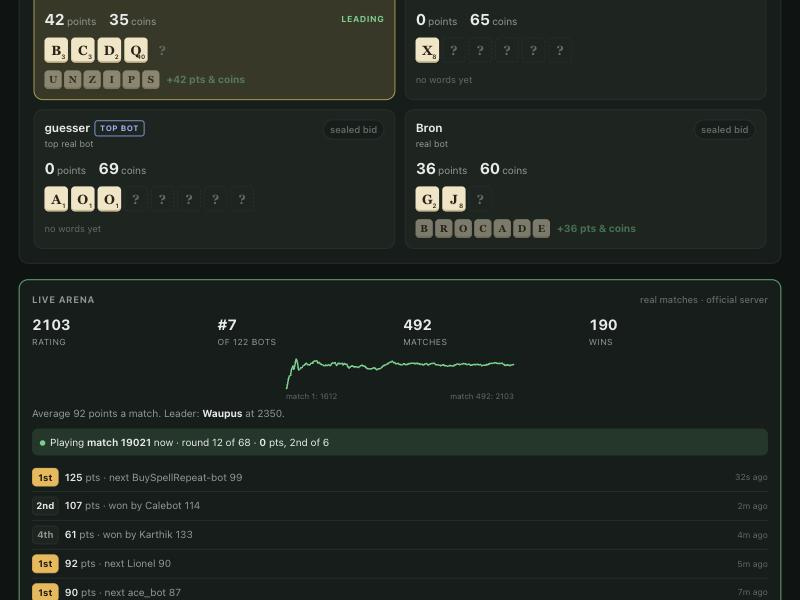

# Nijello

A bot for the [ScrabbleBot](https://scrabblebot.spacetimedb.com) arena (Cal Hacks 13.0 track).
It learns by evolution in a simulator of the arena, built from every public match played there,
and plays live 24/7 on a small GPU box.



*The viewer streaming one of Nijello's real matches: the letter up for auction, each bot's
coins, points and rack (hidden letters show as ?), and Nijello in gold.*

**What's happening right now, timeline and next steps: [`docs/STATUS.md`](docs/STATUS.md).**

## Results



**Ladder** (Oct 25, 2026, 08:45 PDT): **#7 of 146** by rating (2105 ±47), with **190 wins in 493
matches (39%)**, behind only Waupus, james and K-13 for win rate in the top 8, and 91.9 points
a match. A fair share of
wins at a 6-bot table is 17%. It reached #1 twice, and #2 earlier this morning; ratings move fast.

**Tournament 1** (Oct 24–25, 68 bots, 4 Swiss rounds at tables of 6, top 6 to the knockout):
Nijello finished the Swiss rounds **40th** with 13 points; the cut needed 18. K-13 won, ahead of
TileShark, Waupus, SookraBot, BuySpellRepeat-bot and wordchoice. Why the ladder form didn't carry
over is the first open question (see [Lessons](#lessons-so-far)).

## The game in one minute

- Six bots each start with **100 coins** and **5 random letters**. The bag holds 98 Scrabble
  tiles (no blanks), so a 6-bot match has 68 auctions.
- Every round one letter is drawn and auctioned with **sealed bids**, one second to bid. In a
  **Vickrey** auction the highest bid wins and pays the *second*-highest bid.
- Any time, a bot can spell a **dictionary word** from its own letters. The word's letter values
  (A=1 … Q, Z=10) times a **length bonus** (1× up to 3 letters, 1.5× at 4, 2× at 5, 2.5× at 6,
  **3× at 7+**) go into both its coins and its score.
- The match ends when the bag is empty. **Most points wins.** Full rules:
  [`bot/RULES.md`](bot/RULES.md).

So the game is about spending coins on the letters that turn into long words, without running out
of coins before the late auctions, and cashing words at the right moment.

## How Nijello plays

All of it is in [`bot/src/strategy.ts`](bot/src/strategy.ts); 48 numbers control it, and
training tunes all 48.

1. **What is a letter worth to me?** For the letter on sale it compares the rack with and
   without it: how much the best word I can play now improves, how much the best 7+ letter word
   improves, and how much the rack's potential changes. Potential is a learned "keep value" for
   each of the 26 letters, minus penalties for a bad vowel balance, duplicates, and a Q without a U.
   It also adds a little for letters that would help a rival (denying them).
2. **How much to bid?** Its value of the letter times a multiplier that grows with the coins it has
   per auction still to come, capped at a share of its coins. In first-price auctions it shades
   the bid down.
3. **When to spell a word?** It plays a word when the coins and points it pays now are worth more
   than keeping the letters for something longer. Short of coins, cashing gets more attractive.
   With `BINGO_RULE=1` ([`bingo.ts`](bot/src/bingo.ts)) it plays any 7+ letter word at once,
   unless the letter up for auction would make it longer.
4. **Memory:** it tracks which letters are still unseen (the bag plus rivals' hidden starting
   letters) from every public bid and word.
5. **Look-ahead** ([`planner.ts`](bot/src/planner.ts), live with `PLAN=12,450`): in the last 12
   auctions it plays the rest of the match out many times for each candidate bid, with rivals
   played by their models, and keeps the bid that finishes best. Up to 450 ms per decision.
6. **Endgame:** on the last auction it empties its rack into the best set of words.

## How it learns



*Benchmark win rates per generation of a training run: against models of the top live bots,
the live field as a whole, past champions and the untrained bot. The dashed line is a fair share.*

```
 official server ──public SQL──▶ every bot's public matches
        ▲                               │
        │ bids, words                   ▼
  bot/live/bot.ts                opponent models: a bid model and a word-play style per real bot
  (48 numbers + look-ahead)            │
        ▲                               ▼
        │ runs/live/params.json   simulator (bot/src/game.ts, the server's rules step for step)
        │                               │
  release gate ◀── candidates ◀── training: CMA-ES, 64 candidates × 400 games per generation
  (bot/ops/release.sh)
```

- **Opponent models** ([`profile.ts`](bot/src/profile.ts), [`style.ts`](bot/src/style.ts),
  [`calibrate-bids.ts`](bot/src/calibrate-bids.ts)). Every real bot with 10+ matches gets a bid
  model fitted on its last 80 matches. Only the winning bid of each auction is public; a losing
  bid is only known to be below the price paid, so the fit is a censored (Tobit) regression.
  Each bot also gets a word-play style (how long a word it plays as soon as it can, when it
  settles for short words). The bids are then calibrated so replays of our real matches see the
  same strongest rival bid we actually saw, by stage of the match and by letter.
- **Training** ([`train.ts`](bot/src/train.ts)). CMA-ES, an evolution strategy: each generation
  it tries 64 variations of the 48 numbers, plays each against the same 400 tables, and moves
  toward the ones that finished best. Tables mix models of the top live bots, the field as a
  whole, past champions (self-play) and the server's simple bots, at 2–10 players.
- **Simulator check** ([`fidelity.ts`](bot/src/fidelity.ts)). Replays Nijello's real matches with
  the same opponents, seats and strategy, and compares simulation with reality. One third of the
  matches is held out and never used for fitting.
- **Release gate** ([`release.sh`](bot/ops/release.sh)). A candidate goes live only if it beats
  the live strategy on replays of real matches by more than 2 standard errors. The live bot
  re-reads its strategy at every match start, never mid-match.

## The viewer



[`viewer/`](viewer/) is a small web app (one Node server, one HTML page, no dependencies). It
streams Nijello's real match as it happens, or a slowed-down simulated showcase match; shows the
training run's progress; and the **Live arena** panel above: rating and rank, a rating chart,
the match in progress, and recent results from the official server.

## Setup from scratch

**1. Requirements:** Node 24 (the code is TypeScript run directly by Node, no build step), git,
and a machine with several cores for training. Everything else is optional.

**2. Get the code and the word list.** The word list is the server's own, from
[clockworklabs/scrabblebot](https://github.com/clockworklabs/scrabblebot) (MIT), at the commit
this bot was written against:

```sh
git clone https://github.com/3nvyx/nijello-scabble-bot.git
cd nijello-scabble-bot/bot
curl -fsSL -o data/wordlist.txt \
  "https://raw.githubusercontent.com/clockworklabs/scrabblebot/$(cat data/UPSTREAM_COMMIT)/spacetimedb/wordlist.txt"
npm test                     # rules and dictionary tests
```

**3. Download the arena's public matches and refit the opponents' bid models** (about 2
minutes; no account needed, it reads the public tables anonymously). The repo already ships
fitted models in `bot/data/`, so this step is only for fresh data:

```sh
node src/profile.ts          # writes data/live.json and data/profiles.json
```

**4. Train.** From scratch (or add `--init <params.json>` to start from a strategy you have):

```sh
node src/train.ts --out runs/first --hours 4 --workers 8
node src/bench.ts runs/first/best.json 300 6          # 300 games at 6 players
```

`--workers` is one CPU core each. Leave a core or two free if a live bot runs on the same
machine, and watch the temperature: [`viewer/temp-guard.sh`](viewer/temp-guard.sh) stops
training if it gets too hot. A stopped run continues with `--resume`.

**5. Play live.**

1. On [scrabblebot.spacetimedb.com](https://scrabblebot.spacetimedb.com/account), link your
   spacetimedb.com account: install the CLI (`curl -sSf https://install.spacetimedb.com | sh`),
   run `spacetime login`, then run the `spacetime call scrabblebot connect_id …` command the
   account page shows you.
2. On the **Team** page, create a team and bot, then **Generate token** (shown once).
3. Start the client:

```sh
cd live && npm install
BOT_NAME=<name> BOT_TOKEN=<token> PARAMS=../runs/first/best.json PLAN=12,450 npm start
```

After the first start the token is saved to `live/.token-<name>` (never committed), so restarts
need only `BOT_NAME` and `PARAMS`. `live/run.sh` restarts the client if it ever exits. For a
tournament, add `TOURNAMENT_ID=<id>` once it's announced, and keep the bot online: a registered
bot that's offline is still seated and loses every auction.

**6. Calibrate the simulator on your bot's real matches** (once it has played 100+). These tools
replay your bot's own matches, so they read its log (`live/<name>.log`, written by `run.sh`) and
the strategy it played (`runs/live/params.json`); set `OUR_BOT=<name>`:

```sh
OUR_BOT=<name> node src/fit-styles.ts --shard 0/1 && node src/fit-styles.ts --merge 1   # word-play styles
OUR_BOT=<name> node src/calibrate-bids.ts --rounds 10 --reps 4 --style data/styles.json --write
OUR_BOT=<name> node src/fidelity.ts --split held --style data/styles.json   # simulator vs reality
```

After any `profile.ts` refit, re-run these. Don't use `profile.ts --calibrate`: it overwrites
the calibration from `calibrate-bids.ts`.

**7. Watch it (optional).** The viewer imports the bot code from `../scrabblebot-evo`, the folder
name on our training machine, so link it once from the repo root:

```sh
ln -s bot scrabblebot-evo
cd viewer && node server.ts --host 127.0.0.1 --port 8090 --arena-bot <name>   # open http://127.0.0.1:8090
```

## Lessons so far

- **Check the simulator against reality before trusting training.** At first, replays of our
  real matches gave Nijello 83% wins where it really won 47%. Opponent models copied only bids,
  not word play, and their top bids were too low. Training against opponents that are too weak
  produced candidates that looked great and didn't help live. After Phase 2 it's 72% vs 47%:
  better, still optimistic.
- **Gate every release on real matches.** The release gate held back nearly every candidate
  from long runs, even ones that looked better in training.
- **Rivals differ in timing, not just bidding.** Chinese Dante spends the same coins as
  Nijello but scores two thirds of its points early, which leaves it more coins mid-game. Nijello
  did the reverse. The bingo rule is the first answer.
- **Ladder form isn't tournament form.** Nijello is top-10 on the ladder but finished the
  tournament's Swiss rounds 40th of 68. Swiss rounds pair bots on similar records, so later tables
  are all strong real bots; whether that, or something else, explains the gap is still open.
- **Table size changes everything.** Prices rise with the number of players, and a strategy
  tuned at 6 falls apart at 9–10 (9% wins at 10 players, below a fair share).
- **Keep the live bot boring.** A reboot once brought Nijello back with an old strategy because
  two settings lived only in a terminal session; the start-at-boot script now sets them. The
  training box also froze three times under full load, close to its 104 °C shutdown point.

## Layout

| Path | What |
|---|---|
| `bot/src/strategy.ts` | the bot's decision logic (48 tuned numbers) |
| `bot/src/game.ts`, `rules.ts`, `dict.ts` | the server's rules, match loop and dictionary |
| `bot/src/opponents.ts`, `profile.ts`, `style.ts`, `tobit.ts`, `calibrate-bids.ts` | opponent models and their fitting |
| `bot/src/train.ts`, `cmaes.ts`, `worker.ts`, `tables.ts` | training |
| `bot/src/fidelity.ts`, `bench.ts`, `snapshots.ts`, `fit-styles.ts` | checks and benchmarks |
| `bot/src/planner.ts`, `bingo.ts` | look-ahead bidding and the bingo rule |
| `bot/src/field.ts`, `monitor.ts`, `dashboard.ts`, `latency.ts` | live data, monitoring, terminal dashboard |
| `bot/live/` | the live client (`module_bindings/` is generated from the server module) |
| `bot/ops/` | release gate and recovery scripts |
| `bot/data/` | fitted opponent models and calibration (small files only) |
| `viewer/` | live web viewer, start-at-boot scripts, temperature guard |
| `docs/` | status, timeline and plans; `docs/images/` screenshots |

Not in the repo: `bot/data/wordlist.txt` (download it, step 2), `bot/data/live.json` (rebuilt
by step 3), training outputs, and the strategy Nijello plays live.
